# Maritime Traffic Analytics

**Live AIS ship tracking on a 3D globe, with port-congestion analysis, silent-ship detection and an AI fleet assistant, backed by a reproducible analytics pipeline.**

Maritime Traffic Analytics tracks live ship traffic from AIS data (currently the North Sea and English Channel) and places it in a global context with ports and maritime infrastructure worldwide. It combines a real-time 3D globe, port-congestion and silent-ship detection, voyage and weather context and a natural-language fleet assistant with a reproducible analytics pipeline that builds an Excel workbook, an interactive dashboard and a findings memo in one command.

Most public ship trackers show you *where* ships are. This project treats the live AIS feed as raw data to derive real insight from: which ships have gone quiet, how congested a port is right now, and what's actually happening around any given vessel, answered by an AI agent that queries live data instead of guessing.

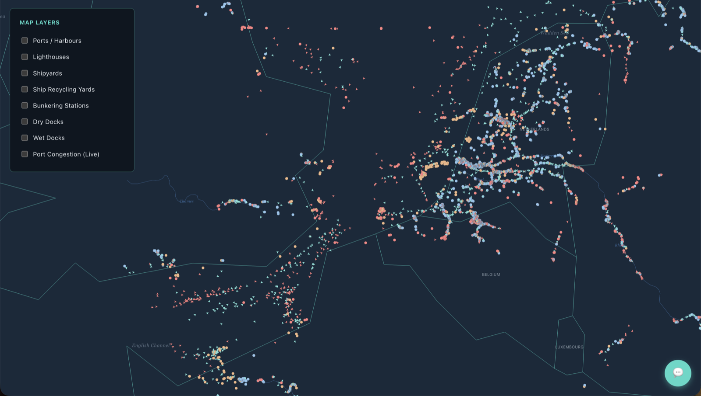

<p>
  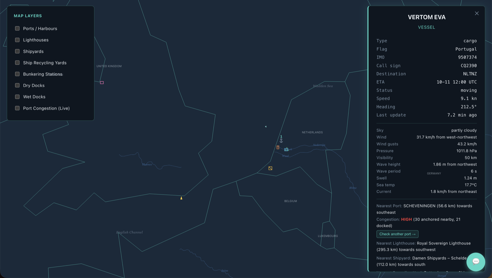
  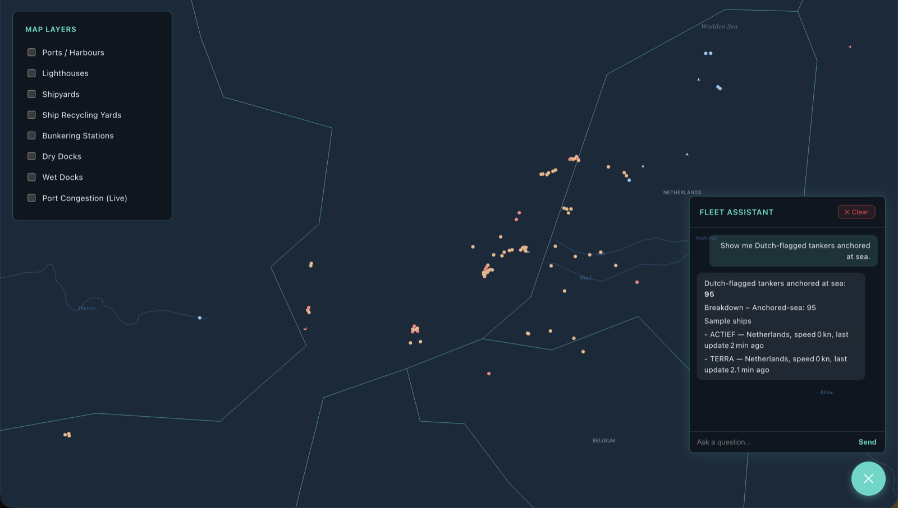
</p>

*Top: live ship traffic. Bottom left: selecting a ship shows its voyage, weather, congestion and nearest facilities. Bottom right: the assistant answers from live data and highlights the result on the globe.*

---

## Table of Contents

- [Problem, solution and approach](#problem-solution-and-approach)
- [What you can do on the globe](#what-you-can-do-on-the-globe)
- [Key Features](#key-features)
- [Also Built In](#also-built-in)
- [Analytics layer](#analytics-layer)
- [Scope: Why Not Every Ship Worldwide?](#scope-why-not-every-ship-worldwide)
- [Tech Stack](#tech-stack)
- [Architecture](#architecture)
- [Getting Started](#getting-started)
- [API Reference](#api-reference)
- [Known Limitations](#known-limitations)
- [Contact & Info](#contact--info)

---

## Problem, solution and approach

**The problem.** Raw ship-tracking (AIS) data looks authoritative but misleads. It is a firehose of position messages with free-text destinations typed by hand, navigation status that crews forget to update (about 30% of ships marked "under way" are actually stationary), missing identifiers (only about 25% of ships carry a valid IMO number), and a mix of cargo ships, tugs, ferries, pleasure craft and inland barges. Raw counts therefore overstate movement, blur seagoing and local traffic, and make ships that simply went quiet look suspicious. Operators and analysts need trustworthy answers to simple questions: where are ships waiting, what does that waiting cost, and which signals are real?

**The solution.** A live maritime intelligence tool for the North Sea and English Channel with two layers:
- **An application:** a 3D globe with ports and maritime infrastructure worldwide, per-ship voyage and weather context, silent-ship ("dark fleet") alerts, port congestion, and an AI assistant that answers questions from the live fleet data.
- **An analytics pipeline:** it cleans the feed, measures congestion per port hub, separates fleet segments, and estimates the fuel and cost of ships waiting at anchor, delivered as an Excel workbook, an interactive dashboard and a findings memo.

**How it works.**
1. **Ingest.** Live AIS from AISStream flows into a FastAPI backend, alongside the World Port Index and curated facility lists for context.
2. **Clean.** Every rule is explicit and counted: impossible speeds, IMO checksums, free-text destinations normalised, and ships classified by speed as well as status.
3. **Model.** Ships are assigned to 19 port hubs; "waiting" means anchored at sea inside a hub's radius; congestion levels are relative (green, yellow, red).
4. **Verify.** Headline numbers are computed twice, in pandas and in SQL, and cross-checked. Silent-ship rates are compared on equal-age windows, which removed a bias found during the analysis.
5. **Answer.** The AI assistant uses function calling over live data, so replies come from the data and not from the model's memory.
6. **Track over time.** A history collector stores per-hub summaries every 30 minutes, and time views (daily levels, weekday patterns) appear as data accumulates.

---

## What you can do on the globe

### Map layers (left panel)

Eight toggles in the **Map Layers** panel switch infrastructure on and off, so you see only what you need. Click any marker for its details.

| Layer | What appears |
|---|---|
| Ports / Harbours | About 3,630 ports from the NGA World Port Index |
| Lighthouses | Curated real lighthouses worldwide |
| Shipyards | Curated major shipyards |
| Ship Recycling Yards | Major ship-breaking yards |
| Bunkering Stations | Major ship-fuelling hubs |
| Dry Docks and Wet Docks | Major dock facilities |
| Port Congestion (Live) | Ports in the tracked region coloured green, amber or red from live ship density; the marker panel shows anchored and docked counts |

### Ships

- **Colour shows status:** moving, anchored at sea, moored in port, or silent for 20+ minutes (red). Moving ships are arrows pointing along their heading; the rest are dots.
- **Click a ship** for its panel:
  - identity: type, flag, IMO, call sign
  - voyage: destination, ETA, and the port it departed from, when detected
  - status, speed, heading and how long ago it last reported
  - a **silent-ship alert** if it has stopped reporting
  - **live weather** at its position: sky, wind and gusts, pressure, visibility, wave height and period, swell, sea temperature, current
  - the **nearest** port, lighthouse, shipyard, recycling yard, bunkering station, dry dock and wet dock, each with distance and compass direction
  - the **congestion level** of the nearest port, and **Check another port →**, which cycles through farther ports, each numbered on the globe
- Selecting a ship dims the others so it stands out.

### AI fleet assistant

Click the chat button (bottom right) and ask in plain English. It answers from the live fleet data, not from the model's memory, and it remembers the conversation, so follow-ups like "show them on the map" work.

| You can ask about | Examples |
|---|---|
| Counts and filters | "Show me Dutch-flagged tankers anchored at sea." "How many Panama-flagged tankers are there?" |
| Ports and activity | "Which is busier, Rotterdam or Antwerp?" "Moving cargo ships near Antwerp with a destination set." |
| Voyages | "Which ships departed from Antwerp?" "Which ships are heading to Rotterdam?" |
| Silent ships | "Any ships silent for more than 30 minutes near Rotterdam?" |
| Lookups | "Point me to VOE VANGUARD." "Find the ship with IMO 9708382." "Where is Portland Head Light?" "Show me all Damen shipyards." |
| Distances | "How far is Hamburg from Rotterdam, and in which direction?" |

It says so when it can't answer, for example for ships outside the tracked region or departures before the server started, and it doesn't invent details. Its counts use the navigation status ships report, so a figure like "moving" can differ from the analytics layer, which also uses speed.

### Point and fly

Ask for a specific ship or facility, by name, IMO number, flag, vessel type, destination, departure port or any combination, and the globe responds:
- **One match:** the camera flies there and opens its panel.
- **Several matches:** the camera frames them all; facilities get numbered markers and matching ships stay bright while the rest dim. Results above 500 ships are counted but not highlighted.
- **Clear** in the chat header resets the view.

---

## Key Features

| Feature | What it does |
|---|---|
| 🔴 **Dark-fleet / AIS-gap detector** | Flags any ship silent for 20+ minutes, a simplified version of a technique used in sanctions-evasion and illegal-fishing monitoring. Computed live from real AIS timestamps. In the analysis, most flags on live North Sea data were stationary harbour craft and reception gaps, so it is best read as a signal-gap indicator. |
| 🟢 **Live port congestion** | For every port in the tracked region, computes a live congestion score from real ship density (anchored ships within 15 km, docked count, traffic). Explicitly scoped as a *live estimate*, not a forecast; the history collector now builds the data needed to study trends. |
| 💬 **AI fleet chat assistant** | Ask questions in plain English, such as *"how many tankers are idling near Rotterdam?"* or *"which Belgian port is busiest right now?"*, and get answers grounded in the live fleet. Powered by Groq (`openai/gpt-oss-120b`) with function-calling: the model decides *what* to query, the backend runs the real filter against live data, and the model only writes the final sentence. |

## Also Built In

- **Real vessel identity**: flag (derived from the MMSI's official ITU country code), IMO number, and call sign, from live AIS static data
- **Full live weather per ship**: wind speed/direction/gusts, sky condition with storm flag, pressure, visibility, wave height/period, swell, sea temperature, ocean current
- **Nearest-facility awareness**: real distance and compass bearing from any ship to the nearest port, lighthouse, shipyard, recycling yard, bunkering station, dry dock, and wet dock
- **Global infrastructure data**: ~3,630 real ports (NGA World Port Index) plus curated real shipyards, lighthouses, recycling yards, bunkering stations, and dry/wet docks, all as toggleable map layers
- **Interactive port-checker**: "Check another port →" cycles through progressively farther ports from a selected ship, each numbered live on the globe
- **Voyage data**: destination and ETA from AIS, plus departure ports detected live when a ship leaves a known port. The departure log is saved to disk and survives restarts, but only covers departures observed while the server was running
- **Smarter chat**: remembers the conversation, looks up ships by name or IMO and facilities by name, filters by flag, departure port and destination, and highlights whole result sets on the globe

## Analytics layer

A reproducible analysis pipeline sits on top of the live feed (`analysis/`). One command, `python analysis/run_all.py`, pulls the current fleet, cleans it, runs SQL and pandas analysis, and builds an Excel workbook, an interactive dashboard and a written findings memo. A full run over about 9,400 ships takes a few seconds on a normal laptop. Setup and details are in [`analysis/README.md`](analysis/README.md).

**What it found** (North Sea & English Channel, snapshot of 11 Oct 2026, about 6,900 current ships):

- **Data quality.** Only about 25% of ships carry a valid IMO number. Destinations are free text typed by hand, and cleaning raised the share resolved to a port from about 28% to about 35%. About 30% of ships whose status says "under way" are actually stationary, so ships are classified by speed as well as status.
- **What the feed contains.** Only about 16% of current ships are under way and about 44% are moored, and about 69% are under 100 m. It is a harbour-dominated feed (tugs, ferries, pleasure craft, inland barges and cargo ships), not open-sea shipping.
- **Congestion.** Rotterdam and Amsterdam have the most ships waiting at anchor (about 70 each), followed by Antwerp (about 30). This is one snapshot; trends need the history collector.
- **Silent ships.** About 8% of ships heard in the last hour had been silent for 20+ minutes. About 86% of them were stationary when last heard, and the rate was similar at the edge of the tracked area and in the interior (about 7-8% in both). A first calculation suggested a large edge effect, but it was an artefact of how long silent ships are retained, and it disappeared when ships of the same age were compared.
- **Cost of waiting (estimate).** Ships at anchor near hubs burn roughly 140-780 t of fuel and cost about $1.5-4 million per day, built from published fuel and operating-cost ranges. This is an upper bound for congestion-attributable cost, not a measured loss.

**Method highlights.** Every cleaning rule is counted and reported. The same headline numbers are computed in pandas and in SQL and cross-checked. A history collector stores per-hub summaries every 30 minutes, and time views (daily levels, weekday and weekly patterns) switch on as data accumulates.

**Limits.** One region only; AIS coverage comes from land-based receivers, so open-sea traffic is under-represented; fuel, CO2 and cost are estimates with explicit assumptions and sources; AIS has no operator or cargo data, so no company-level loss can be computed.


### Dashboard screenshots

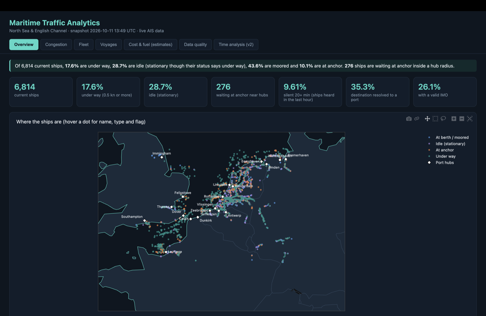
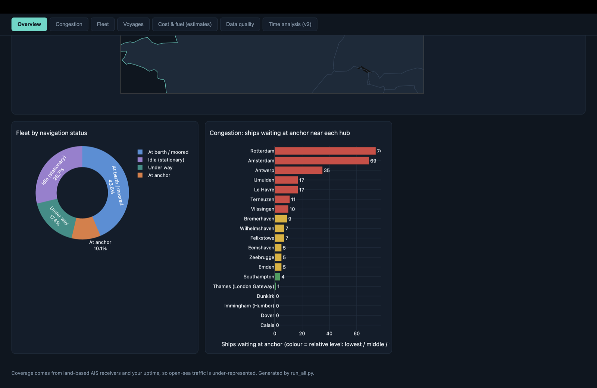
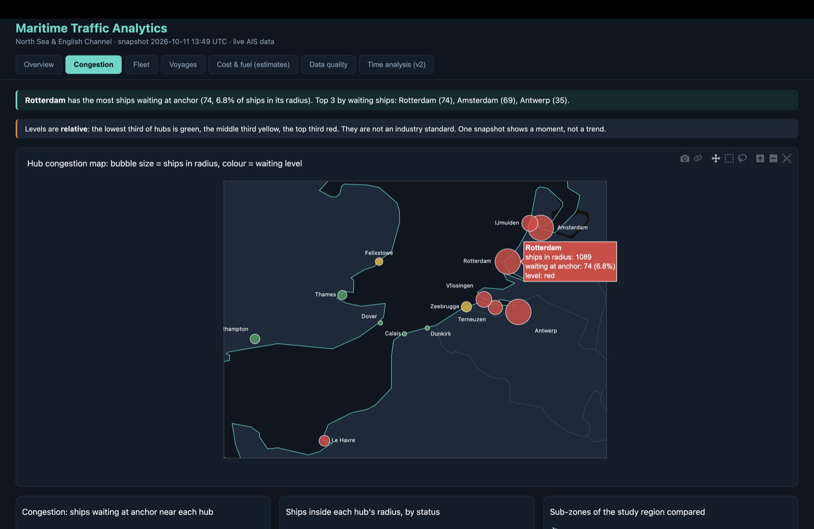
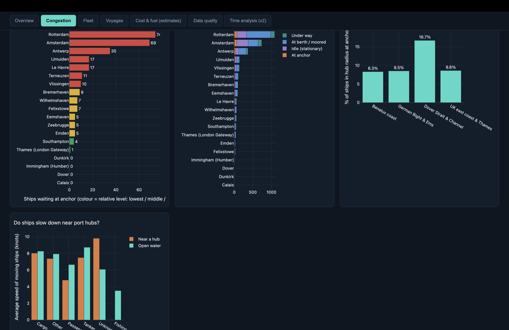
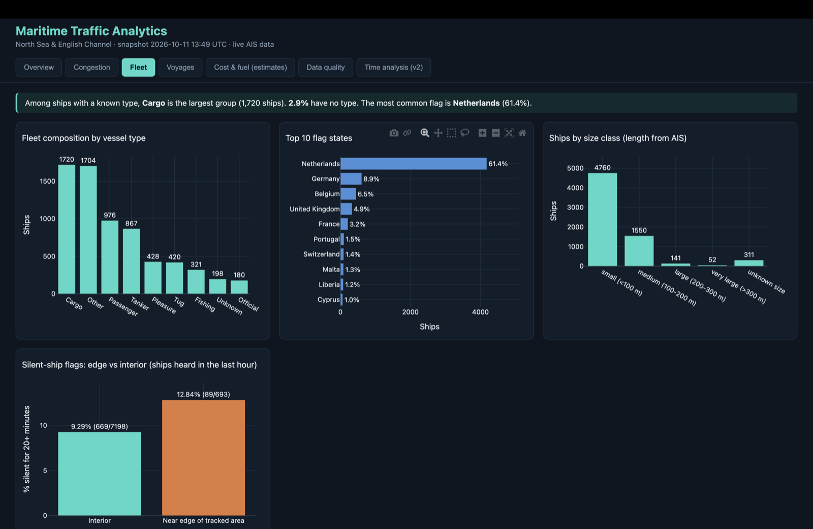
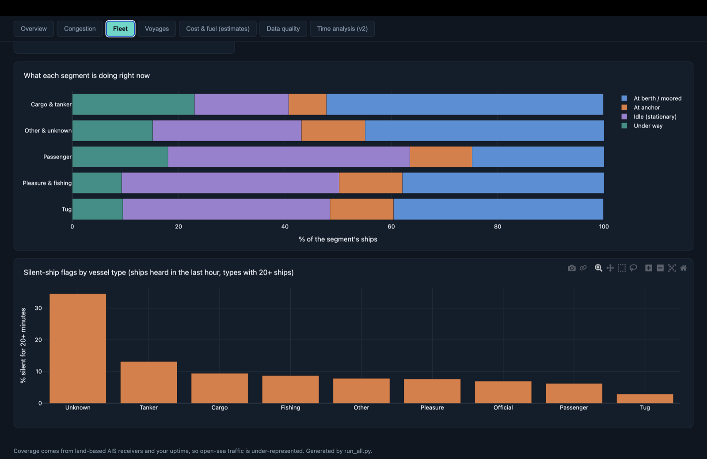
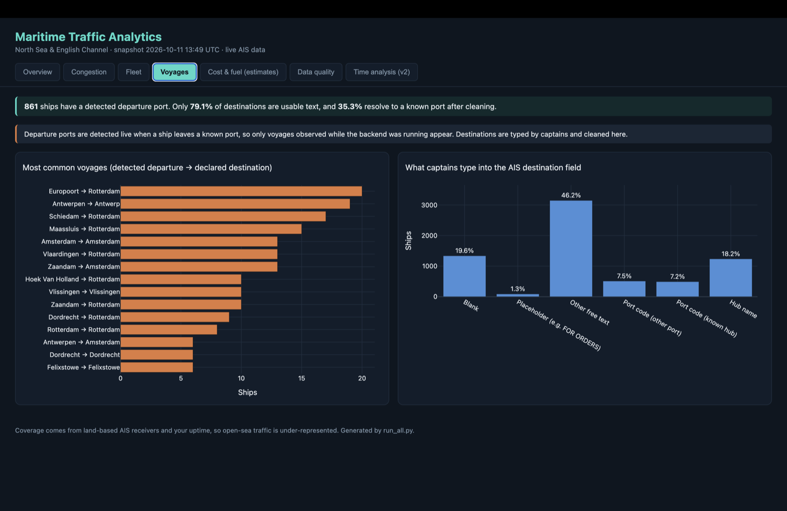
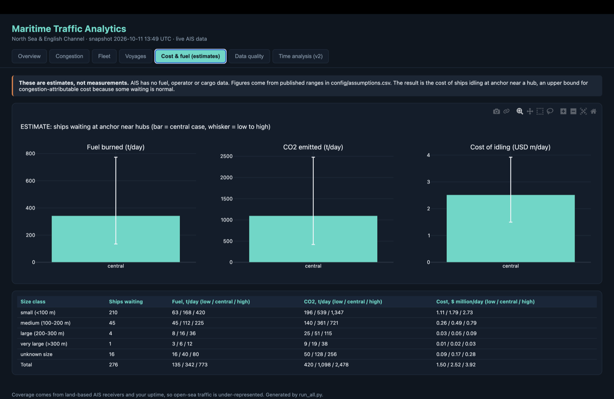
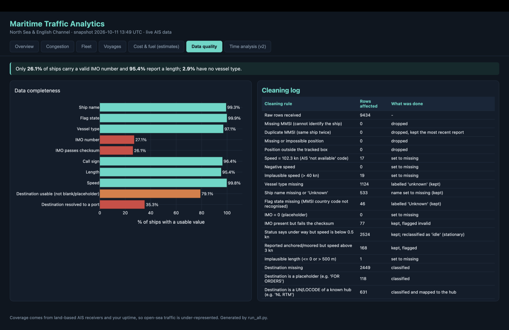
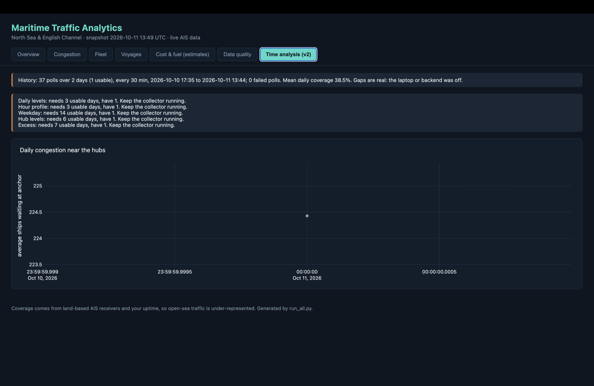


1
## Scope: Why Not Every Ship Worldwide?

Live ship tracking covers the North Sea and English Channel by design. Rendering every ship on Earth in the browser is not affordable for a free-tier, client-rendered app, and the free AIS data would not be complete anyway. The region is one of the world's busiest and best-covered shipping areas, which keeps the globe smooth and the backend within free-tier limits. The three reasons:

1. **AIS coverage isn't actually global.** Free feeds like [AISStream.io](https://aisstream.io) rely on a community network of land-based receivers, strong near coastlines, and dropping off sharply in open ocean. Closing that gap needs *satellite* AIS, a paid commercial product (Kpler, Spire, etc.). "All ships worldwide" on a free tier would mean busy coastlines and empty oceans, a worse product than one honestly scoped.
2. **Rendering cost.** Every ship is a live 3D object, rebuilt on every 10-second poll. The current North Sea/English Channel region alone regularly holds 1,000-3,000+ live ships. Global scale would need a different rendering strategy (GPU instancing, clustering) to stay smooth in a browser.
3. **Payload size.** `/ships` returns the full tracked fleet on every poll. At global AIS volume that payload reaches multiple megabytes every 10 seconds, which is untenable on free-tier infrastructure.

**What this means for the features.** The reference data (about 3,630 ports and the curated facility lists) is global. Anything that depends on ship positions (dark-fleet flags, congestion scores, nearest-port distances for a ship, the analytics pipeline) covers the tracked region. The backend's tracking box is one line of config; the analytics layer would also need hubs, region labels and regional assumptions for each new region. See [Extending beyond one region](analysis/README.md#extending-beyond-one-region).

## Tech Stack

| Layer | Technology |
|---|---|
| Frontend | React, TypeScript, Vite, [react-globe.gl](https://github.com/vasturiano/react-globe.gl) (Three.js) |
| Backend | Python, FastAPI, async WebSocket |
| Live AIS data | [AISStream.io](https://aisstream.io) |
| Port data | [NGA World Port Index](https://msi.nga.mil/Publications/WPI) |
| Weather data | [Open-Meteo](https://open-meteo.com) (marine + atmospheric, free, no key) |
| AI chat | [Groq](https://groq.com) (`openai/gpt-oss-120b`, function-calling) |
| Analytics | Python, pandas, SQL (SQLite), Plotly, matplotlib, openpyxl (Excel), Streamlit (optional) |

## Architecture

```
AISStream.io (WebSocket)
        │
        ▼
FastAPI backend ──► in-memory live ship store
        │                 │
        │                 ├──► dark-fleet flagging
        │                 ├──► port congestion scoring
        │                 └──► /chat (Groq function-calling)
        ▼
REST endpoints (/ships, /ships/dark-fleet, /chat)
        │
        ├──► React frontend ──► react-globe.gl (3D render)
        │         ├──► Open-Meteo (weather, per selected ship)
        │         └──► NGA World Port Index (global port data)
        │
        └──► analysis/ (analytics layer)
                  ├──► run_all.py: clean → SQL + pandas → charts, Excel, dashboard, findings memo
                  └──► collector.py: per-hub summaries every 30 min → history.db → time analysis
```

## Getting Started

### Prerequisites
- Python 3.10+
- Node.js 18+
- A free [AISStream.io](https://aisstream.io) API key
- A free [Groq](https://console.groq.com) API key (for the chat assistant)

### Backend

```bash
cd backend
python3 -m venv venv
source venv/bin/activate
pip install -r requirements.txt
```

Create `backend/.env`:

```
AISSTREAM_API_KEY=your_key_here
GROQ_API_KEY=your_key_here
```

Run it:

```bash
uvicorn main:app --reload
```

### Frontend

```bash
cd frontend
npm install
npm run dev
```

Open `http://localhost:5173`.

### Analytics

With the backend running, from the project root:

```bash
python3 -m venv analysis/.venv
source analysis/.venv/bin/activate
pip install -r analysis/requirements.txt
python analysis/run_all.py
```

Results are written to `analysis/outputs/` (dashboard, workbook, findings memo). To build history for the time views, run `python analysis/collector.py` in its own terminal. See [`analysis/README.md`](analysis/README.md) for options.

## API Reference

| Method | Endpoint | Description |
|---|---|---|
| `GET` | `/ships` | All currently tracked ships, with dark-fleet flags applied |
| `GET` | `/ships/dark-fleet` | Only ships currently flagged as dark |
| `POST` | `/chat` | AI fleet assistant. Send `{ "message": "...", "history": [...] }`, get `{ "reply", "ships", "facilities" }` back |

## Known Limitations

- No operator or build-year data: this doesn't exist in AIS broadcasts. The only real source (Equasis) requires a login with no public API, and this project doesn't build scrapers for authenticated third-party services.
- Some smaller vessels (fishing boats, pleasure craft, Class B AIS transponders) never broadcast an IMO number, a real limitation of the ship's equipment, not a bug.
- Live ship tracking is scoped to the North Sea/English Channel (see [Scope](#scope-why-not-every-ship-worldwide) above).
- Navigation status is typed by the crew and often stale (about 30% of ships marked "under way" were stationary), so the analytics layer classifies ships by speed as well.
- Fuel, CO2 and cost figures are estimates from published ranges, not measurements; AIS has no operator or cargo data.
- Departure ports are only recorded for departures observed while the server is running. Ships that left port before that are unknown, and "departed yesterday"-style questions can't be answered.
- Ships are dropped from the live list after 60 minutes of silence if they were last seen near the edge of the tracked area, and after 24 hours if they went silent well inside it. A ship that really switched off its transponder near the edge cannot be told apart from one that sailed out of coverage.

## Contact & Info

* **Analyst:** Mohammed Faraaz Shaik — [faraazshaik05042005@gmail.com](mailto:faraazshaik05042005@gmail.com)
* **LinkedIn:** [linkedin.com/in/mohammed-faraaz-shaik](https://www.linkedin.com/in/mohammed-faraaz-shaik)
* **GitHub:** [FaraazonMac](https://github.com/FaraazonMac)