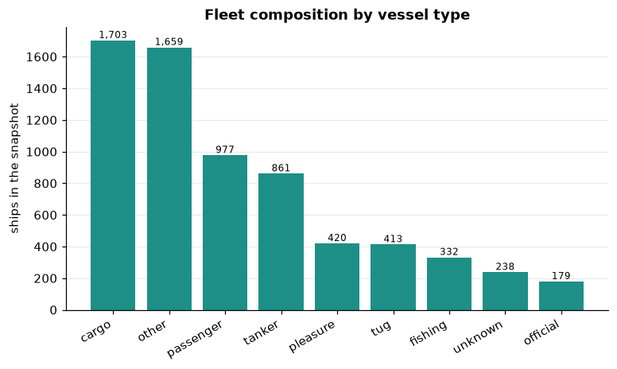
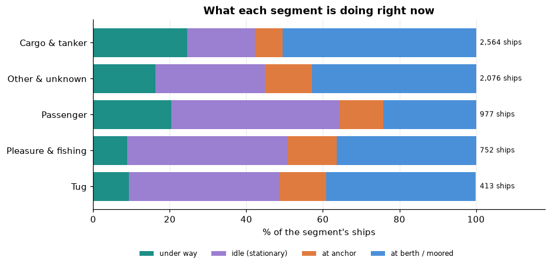
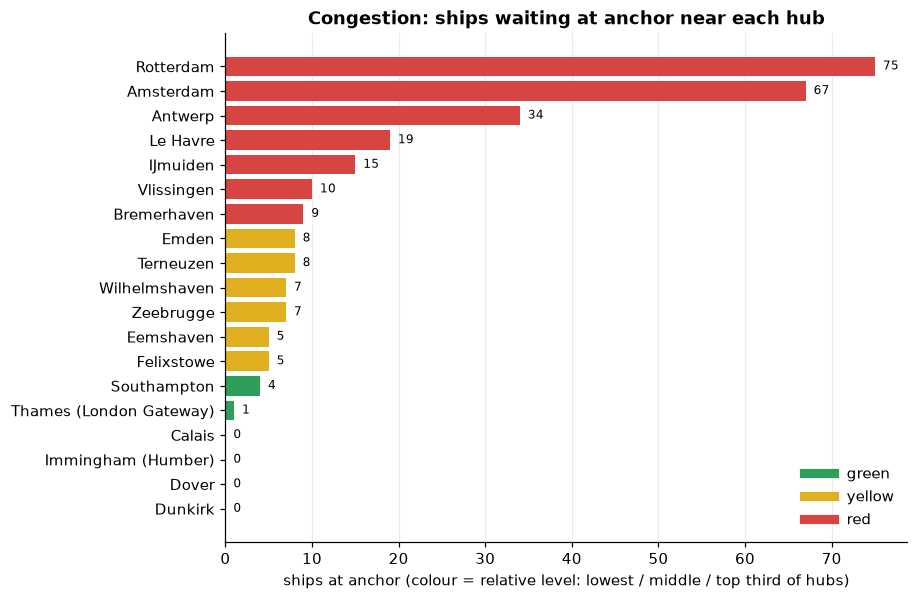
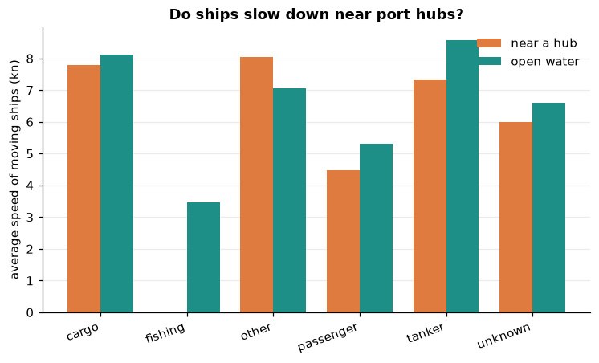
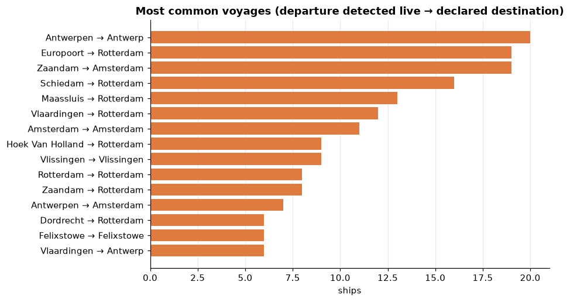
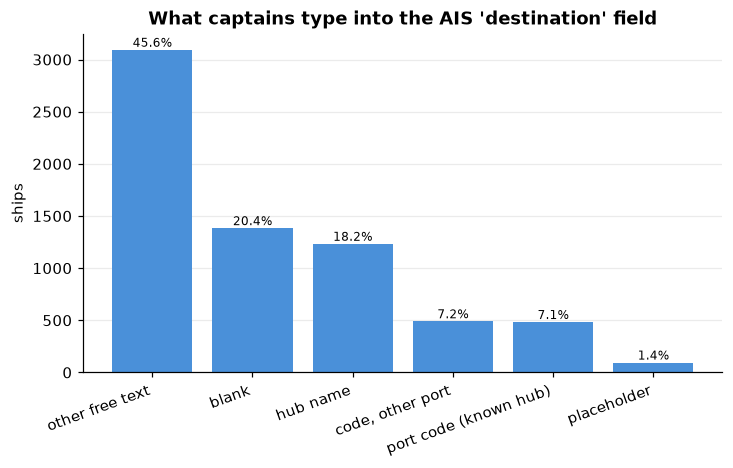
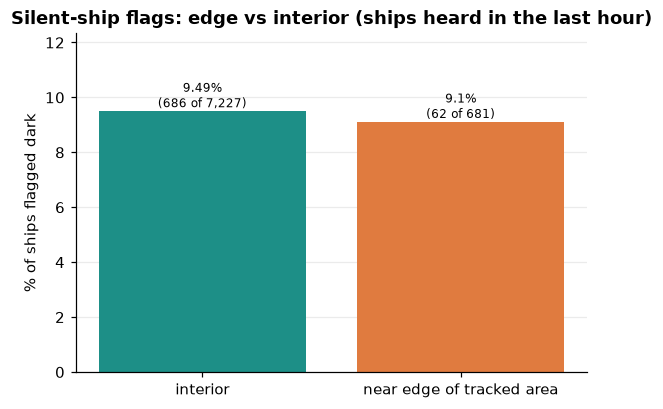
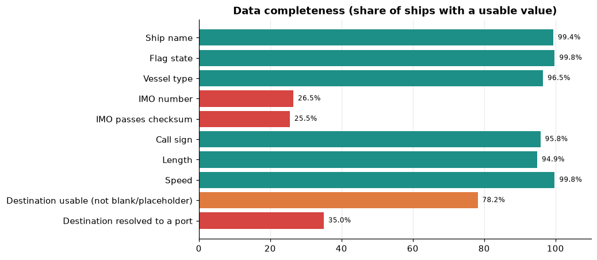
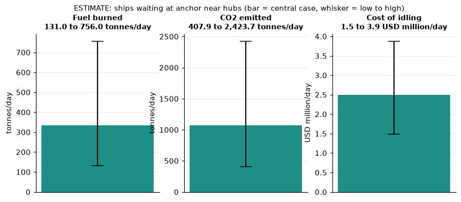

# Maritime Traffic Analytics: North Sea & English Channel

_Snapshot: 2026-10-11 13:07 UTC · 6,782 current ships · generated by `run_all.py`. Every number below is computed from the data; interpretation lines are marked and should be reviewed by the analyst._

## Executive summary

- **Fleet.** 6,782 ships were current (heard from in the last 15 minutes): 18.7% under way (speed 0.5 kn or more), 28.8% idle (stationary although the status says under way), 10.3% at anchor, 42.2% moored. 3,119 were inside the radius of one of 19 port hubs. 2,594 further ships had gone silent and are used only for the dark-fleet analysis.
- **Congestion.** Rotterdam had the most ships waiting at anchor (75, 7.2% of ships in its radius). Top 3 by waiting ships: Rotterdam (75), Amsterdam (67), Antwerp (34).
- **Speed.** Ships under way average 6.6 kn near hubs and 7.2 kn in open water (-0.5 kn difference).
- **Silent-ship flags (the app's 'dark fleet').** 9.46% of the 7,908 ships heard from in the last hour have been silent for 20+ minutes. 83.8% of them were stationary (moored, at anchor or idle) when last heard and 12.8% have no vessel type (against 3.5% of current ships), so most gaps look like harbour traffic and reception gaps, not deliberate shutdowns. Edge vs interior: 9.10% near the edge vs 9.49% in the interior (-0.39 points, approx. 95% interval +/-2.26): no statistically clear difference.
- **Data quality.** Only 25.5% of ships carry a valid IMO number and 3.5% have no vessel type. Cleaning free-text destinations raised the share resolved to a port from 27.4% to 35.0%.
- **Estimated cost of waiting (estimate, not measured).** Ships at anchor near hubs burn roughly 131 to 756 t of fuel and cost about $1.5 to 3.9 million per day (central case $2.5 million).

## Findings

### 1. Fleet composition

Among ships with a known type, **cargo** is the largest group (1,703 ships, 25.1% of the fleet). 3.5% of ships have no type at all, so type shares describe the typed ships only.
The most common flag is **Netherlands** (61.3%). The top 3 flags together cover 77.0% of ships.

**Who is in the data?** The feed mixes seagoing and local traffic (tugs, ferries, pleasure craft, inland barges), and each segment behaves differently, so one fleet-wide average would hide most of the story:

| segment | ships | share_pct | pct_under_way | pct_idle | pct_at_berth | pct_at_anchor | waiting_near_hubs | avg_speed_under_way_kn |
|---|---|---|---|---|---|---|---|---|
| Cargo & tanker | 2564 | 37.8 | 24.5 | 17.7 | 50.6 | 7.3 | 72 | 8.1 |
| Other & unknown | 2076 | 30.6 | 16.3 | 28.6 | 42.8 | 12.3 | 103 | 7.1 |
| Passenger | 977 | 14.4 | 20.4 | 43.8 | 24.4 | 11.5 | 50 | 4.9 |
| Pleasure & fishing | 752 | 11.1 | 8.8 | 42.0 | 36.4 | 12.8 | 25 | 3.7 |
| Tug | 413 | 6.1 | 9.4 | 39.2 | 39.0 | 12.3 | 24 | 4.9 |

### 2. Congestion hotspots

| hub | zone | ships_in_radius | at_anchor | idle | waiting_broad | pct_at_anchor | level_waiting |
|---|---|---|---|---|---|---|---|
| Rotterdam | Benelux coast | 1036 | 75 | 258 | 333 | 7.2 | red |
| Amsterdam | Benelux coast | 725 | 67 | 298 | 365 | 9.2 | red |
| Antwerp | Benelux coast | 382 | 34 | 85 | 119 | 8.9 | red |
| Le Havre | Dover Strait & Channel | 64 | 19 | 13 | 32 | 29.7 | red |
| IJmuiden | Benelux coast | 142 | 15 | 38 | 53 | 10.6 | red |
| Vlissingen | Benelux coast | 133 | 10 | 48 | 58 | 7.5 | red |
| Bremerhaven | German Bight & Ems | 95 | 9 | 25 | 34 | 9.5 | red |
| Terneuzen | Benelux coast | 111 | 8 | 23 | 31 | 7.2 | yellow |

**Sensitivity to the definition of waiting.** Strict = anchored at sea; broad = anchored plus idle (stationary although the status says under way). 4 of the top 5 hubs are the same under both definitions (rank correlation 0.92). The ranking is robust to the definition.

Across sub-zones, **Benelux coast** has the most ships at anchor (216), while **Dover Strait & Channel** has the highest share of ships at anchor (19.0%).
_Interpretation (review): levels are relative to the other hubs, from a single moment. A red hub is busy compared with the others today; this snapshot cannot say whether that is normal for that hub. That needs the time analysis._

### 3. Do ships slow down near hubs?

Overall: ships are slower near hubs (6.6 kn near hubs, 7.2 kn in open water; 392 and 871 moving ships).
 The largest slowdown among the main types is for **tanker** (-1.2 kn).

_Interpretation (review): a speed gap near hubs would be consistent with queuing and manoeuvring, but moving-ship speed near a port also reflects pilotage rules and speed limits, so treat this as a signal, not proof of congestion._

### 4. Voyages and destinations

819 ships have a detected departure port. The most common voyage observed is **Antwerpen → Antwerp** (20 ships).

Captains type destinations by hand: 20.4% are blank and 1.4% are placeholders such as 'FOR ORDERS'. 7.1% are port codes for a known hub and 18.2% name a known hub, which cleaning maps to a real port.

### 5. Silent ships (the 'dark-fleet' flag)

Only ships heard from in the last 60 minutes are compared. The backend keeps silent ships longer in the interior than near the edge of the tracked area, so including older ships would manufacture a difference between the two.

Edge versus interior: 9.10% near the edge vs 9.49% in the interior (-0.39 points, approx. 95% interval +/-2.26): no statistically clear difference.

Of the 748 flagged ships, **83.8%** were stationary when last heard (16.2% were under way), 42.5% were inside a hub radius, the median silence is 30 minutes, and **12.8%** have no vessel type (current ships: 3.5%). Ships with no type are ones heard only a few times, so many flags are simply ships at the fringe of reception.

_Interpretation (review): the flag means 20+ minutes without a message. On this evidence it measures signal gaps and powered-down harbour craft, not suspicious behaviour, so call it a signal-gap or silent-ship indicator; it cannot separate a deliberate shutdown from a coverage gap._

### 6. Data quality

The least complete fields: **IMO passes checksum** (25.5%); **IMO number** (26.5%); **Destination resolved to a port** (35.0%). 1952 ships (28.8% of the fleet) have a status that says under way but are stationary, and 107 report anchored or moored while moving fast. Status is typed by hand and often not updated, so this analysis classifies ships by speed as well as status.

### 7. Estimated fuel, CO2 and cost of ships waiting at anchor (ESTIMATE)

274 ships were at anchor inside a hub radius. Using the assumptions in the appendix, they burn about **131 to 756 t of fuel**, emit **408 to 2,424 t of CO2** and cost **$1.5 to 3.9 million** per day (low to high; central 334 t, 1,071 t, $2.5 million).

**How to read this honestly:** it is the cost of ships idling near a hub on a typical day, an upper bound for congestion-attributable cost because some waiting is normal. 16 of the waiting ships have no length in the data and use medium-ship assumptions. AIS has no fuel, operator or cargo data, so no company-level loss can be computed.

## Time analysis (v2)

History: 35 polls over 2 days (1 usable with at least half the expected polls), every 30 minutes, 2026-10-10 17:35 to 2026-10-11 12:44; 0 failed polls; mean daily coverage 36.5%. Gaps are real: the laptop or backend was off.

_Not yet available:_ Daily levels: needs 3 usable days, have 1. Keep the collector running. Hour profile: needs 3 usable days, have 1. Keep the collector running. Weekday: needs 14 usable days, have 1. Keep the collector running. Hub levels: needs 6 usable days, have 1. Keep the collector running. Excess: needs 7 usable days, have 1. Keep the collector running.

## Recommendations (draft: edit to your own judgement)

- Put Rotterdam, Amsterdam, Antwerp on a watch list and track their waiting ships hourly; they lead the congestion ranking in this snapshot.
- Improve vessel identification: only 25.5% of ships have a valid IMO, so many ships cannot be matched to registry data (size, owner, age).
- Normalise destination text at the source (UN/LOCODE parsing, as done here) before using it for voyage analysis.
- Add ship size (length and beam from AIS) to every record so fuel and cost estimates can be scaled by size class instead of an average.

## Method

1. **Source.** Live AIS positions and static data from AISStream, collected by the Maritime Globe backend (North Sea and English Channel box).
2. **Cleaning.** Every rule and the number of rows it touched:

| rule | rows_affected | action |
|---|---|---|
| Raw rows received | 9376 | - |
| Missing MMSI (cannot identify the ship) | 0 | dropped |
| Duplicate MMSI (same ship twice) | 0 | dropped, kept the most recent report |
| Missing or impossible position | 0 | dropped |
| Position outside the tracked box | 0 | dropped |
| Speed = 102.3 kn (AIS 'not available' code) | 16 | set to missing |
| Negative speed | 0 | set to missing |
| Implausible speed (> 40 kn) | 19 | set to missing |
| Vessel type missing | 1136 | labelled 'unknown' (kept) |
| Ship name missing or 'Unknown' | 512 | name set to missing (kept) |
| Flag state missing (MMSI country code not recognised) | 44 | labelled 'Unknown' (kept) |
| IMO = 0 (placeholder) | 0 | set to missing |
| IMO present but fails the checksum | 77 | kept, flagged invalid |
| Status says under way but speed is below 0.5 kn | 2471 | kept; reclassified as 'idle' (stationary) |
| Reported anchored/moored but speed above 3 kn | 165 | kept, flagged |
| Implausible length (<= 0 or > 500 m) | 2 | set to missing |
| Destination missing | 2451 | classified |
| Destination is a placeholder (e.g. 'FOR ORDERS') | 117 | classified |
| Destination is a UN/LOCODE of a known hub (e.g. 'NL RTM') | 628 | classified and mapped to the hub |
| Destination names a known hub | 1540 | classified and mapped to the hub |
| Silent for more than 15 minutes (stale) | 2594 | kept; excluded from traffic metrics, used only for the dark-fleet analysis |
| Clean rows kept | 9376 | - |

3. **Hubs.** Each ship is assigned to the nearest port hub whose radius it is inside (`config/hubs.csv`); otherwise it counts as open water.
4. **Levels.** Hubs (or days) are split into thirds: lowest green, middle yellow, top red. Relative, not absolute.
5. **Cross-check.** The same headline numbers are computed twice, in pandas and in SQL (`sql/`), and compared. Result: hub congestion: ships in radius agree: agree, hub congestion: ships at anchor agree: agree, fleet mix: ships per vessel type agree: agree, dark fleet: flagged count agrees: agree, waiting by size: total agrees: agree.
6. **Estimates.** Fuel, CO2 and cost use the published ranges in `config/assumptions.csv`; low uses every low value together and high every high value.

## Limitations

- One region only (North Sea and English Channel). Findings do not generalise to other seas.
- Coverage comes from land-based AIS receivers, so open-sea traffic is under-represented; counts depend on receiver coverage and on when the backend was running.
- A single snapshot shows one moment. Trends, weekly and monthly patterns need the history collector.
- Navigation status is entered by the crew; 'at anchor' can be wrong or stale.
- Fuel, CO2 and cost are estimates from published assumptions, not measurements. No operator, cargo or schedule data exists in AIS, so no company-level loss can be calculated.
- Departure ports are detected only while the backend is running; ships that left earlier are unknown.

## Appendix: assumptions and sources

| parameter | size_class | low | central | high | unit |
|---|---|---|---|---|---|
| fuel_at_anchor_t_per_day | small (<100 m) | 0.3 | 0.8 | 2.0 | tonnes/day/ship |
| fuel_at_anchor_t_per_day | medium (100-200 m) | 1.0 | 2.5 | 5.0 | tonnes/day/ship |
| fuel_at_anchor_t_per_day | large (200-300 m) | 2.0 | 4.0 | 9.0 | tonnes/day/ship |
| fuel_at_anchor_t_per_day | very large (>300 m) | 3.0 | 6.0 | 12.0 | tonnes/day/ship |
| fuel_at_anchor_t_per_day | unknown size | 1.0 | 2.5 | 5.0 | tonnes/day/ship |
| fuel_price_usd_per_t | all | 880.0 | 1328.0 | 1500.0 | USD/tonne |
| co2_t_per_t_fuel | all | 3.114 | 3.206 | 3.206 | t CO2 per t fuel |
| vessel_opex_usd_per_day | all | 5000.0 | 7474.0 | 10000.0 | USD/day/ship |

Sources:

- **fuel_at_anchor_t_per_day**: Analyst assumption: no published at-anchor figure by ship size exists. Bracketed by: auxiliary-engine use of 0.5-1 t/day for 40-70k DWT tramp ships (Journal of Shipping and Trade, doi 10.1186/s41072-021-00097-z and 10.1186/s41072-017-0021-y); about 4 t/day auxiliary for a large container ship at sea (maritimepage.com/fuel-consumption-how-much-fuel-cargo-ship-use); 9.4 t/day in port including cargo operations for a 19k DWT tanker (doi 10.1186/s41072-018-0031-4).
- **fuel_price_usd_per_t**: Ship & Bunker 6 Oct 2026: 20-port average VLSFO $876.50/mt and MGO $1,500/mt (via shipuniverse.com/?p=22139); Rotterdam conventional LSMGO about $1,328/mt, derived from ENGINE 2 Oct 2026 (B30-LSMGO $1,398 less a $70 premium).
- **co2_t_per_t_fuel**: EU Regulation 2015/757 as amended by Delegated Regulation 2016/2071: HFO 3.114, LFO 3.151, MGO 3.206 t CO2 per t fuel (legislation.gov.uk/eur/2016/2071).
- **vessel_opex_usd_per_day**: Low: running cost of $5,000/day in the tramp-ship tables (doi 10.1186/s41072-017-0021-y). Central: Drewry average daily operating cost across 47 ship types and sizes, $7,474 in 2022 (marinelog.com). High: analyst assumption for larger or more complex ships.